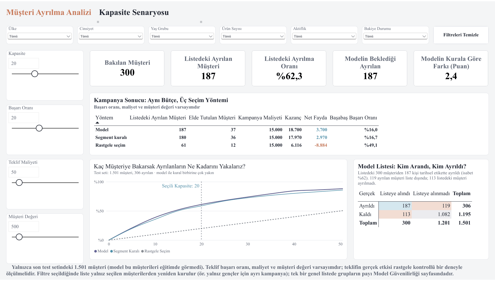
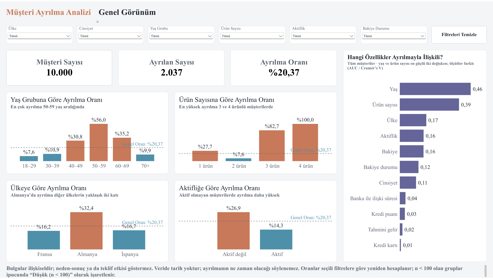
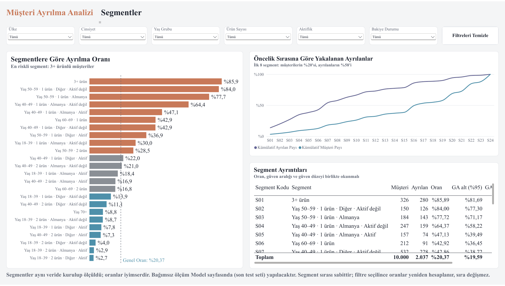
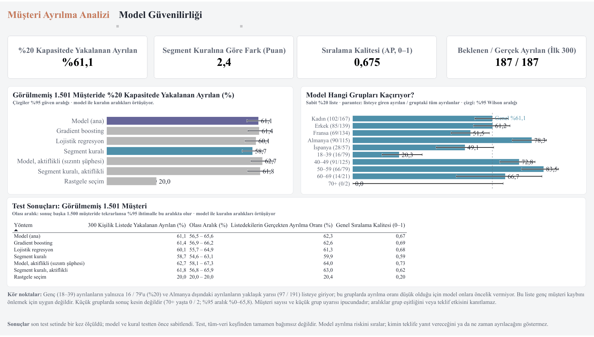

# Banka Müşteri Kaybı Analizi

**Sınırlı kapasiteyle hangi müşterilere öncelik verilmeli?**

Bu, bir iş analisti / veri analisti staj projesi olarak hazırladığım uçtan uca bir müşteri kaybı (churn) çalışmasıdır. SQL Server'da veri kontrolü, Python'da veri incelemesi ve makine öğrenmesi, Power BI'da etkileşimli bir panel içerir.

📄 **Proje raporu:** [reports/son_rapor.pdf](reports/son_rapor.pdf) (7 sayfa)

---

## Soru

Bir bankanın müşteri tutma ekibi herkesi arayamaz. Ayrılacak müşterilerin olabildiğince çoğuna ulaşmak için **öncelikle kimleri aramalı?** Basit bir kural yeterli mi, yoksa bir makine öğrenmesi modeli fark yaratıyor mu?

## Veri

Kaggle'da yayımlanan [Churn Modelling](https://www.kaggle.com/datasets/shrutimechlearn/churn-modelling) veri seti: 10.000 müşteri, 14 alan (yaş, ülke, ürün sayısı, bakiye, aktif üyelik vb.). Müşterilerin %20,4'ü bankadan ayrılmış. Veride tarih ve kampanya bilgisi yok; bulgular bu veri setine aittir.

## Ne yaptım?

1. **SQL Server:** Veriyi yükleyip kalite kontrollerini yaptım (eksik değer, tekrar, geçersiz değer) ve özet sorgular yazdım.
2. **Python, veri incelemesi:** Hangi müşteri gruplarında ayrılmanın yoğunlaştığına baktım. Her oranı müşteri sayısı ve güven aralığıyla birlikte inceledim. Bu incelemeden basit bir segment kuralı çıkardım.
3. **Python, model:** Random Forest, lojistik regresyon ve gradient boosting denedim. Modeli bu basit kuralla ve rastgele seçimle, daha önce hiç görmediği 1.501 müşteride karşılaştırdım.
4. **Power BI:** Dört sayfalık etkileşimli bir panel hazırladım. İlk üç sayfa filtrelere ve kaydırıcılara göre anında güncelleniyor. Bir müşteri grubu seçildiğinde ayrılma oranları, segmentler ve arama listesi yalnız o grup için yeniden hesaplanıyor. Kapasite Senaryosu sayfasında kampanya ekibi kendi varsayımlarını girebiliyor: kaç müşteri aranacağı, teklifin başarı oranı, teklif maliyeti ve müşterinin bankaya değeri. Panel bu varsayımlarla kampanyanın net faydasını hesaplıyor. Başabaş oranını da gösteriyor; bu, kampanyanın bankayı zarara sokmaması için teklifin en az hangi başarı oranına ulaşması gerektiği. Model Güvenilirliği sayfası ise modelin test verisindeki başarısını ve hangi müşteri gruplarını gözden kaçırdığını sabit bir değerlendirme olarak gösteriyor.

## Başlıca sonuçlar

- **Ayrılma birkaç grupta yoğunlaşıyor:** 40–59 yaş müşteriler tüm müşterilerin %35'i ama ayrılanların %64'ü. 3 ve daha fazla ürünü olanların %86'sı, Almanya'daki müşterilerin %32'si ayrılmış.
- **En riskli %20 arandığında** (test grubunda 300 kişi) model ayrılanların **%61'ini**, basit kural **%59'unu** yakalıyor; rastgele seçim %20'sini. Model ile kural arasındaki fark bu kapasitede belirgin değil. Model ise müşterileri genel olarak daha iyi sıralıyor ve "listede kaç kişi ayrılır" sorusuna tutarlı cevap veriyor (187 beklendi, 187 gerçekleşti).
- **Kapasite bir iş kararı:** Örnek varsayımlarla en riskli %20 aranırsa kampanya kâr ediyor; %50 aranırsa zarar ediyor. Liste genç müşterileri (18–39) büyük ölçüde dışarıda bırakıyor.
- **Öneri:** Teklifin gerçek etkisi veride yok. Kampanya yaygınlaştırılmadan önce küçük bir A/B testiyle ölçülmeli; raporda tasarımı ve gereken müşteri sayısı var.

## Power BI paneli

| Sayfa | İçerik |
|---|---|
| Genel Görünüm | Gruplara göre ayrılma oranı (müşteri sayısı ve güven aralığıyla), değişkenlerin gücü, filtreler |
| Segmentler | 24 segment ve yakalama eğrisi |
| Kapasite Senaryosu | Kapasite, teklif başarısı, maliyet ve müşteri değeri kaydırıcıları; kampanyanın net faydası ve başabaş noktası; karışıklık matrisi |
| Model Güvenilirliği | Test sonuçları, gruplara göre yakalama, kör noktalar |

Panel dosyası: [powerbi/Churn_Analysis.pbix](powerbi/Churn_Analysis.pbix)

Aşağıdaki görüntüler panelin sayfalarıdır ve varsayılan kaydırıcı değerleriyle alınmıştır (%20 kapasite, %20 başarı, 50 teklif maliyeti, 500 müşteri değeri). Segment Ayrıntıları gibi bazı tablolar panelde aşağı veya yana kaydırılarak okunur. Tamamını görmek ve filtreleri denemek için `.pbix` dosyasını indirip ücretsiz Power BI Desktop ile açabilirsiniz. Veri dosyanın içinde olduğu için SQL Server kurmadan incelenebilir; yalnız veriyi yenilemek için SQL Server gerekir.

**Kapasite Senaryosu:** varsayımlara göre kampanyanın net faydası, başabaş oranı ve karışıklık matrisi



**Genel Görünüm:** gruplara göre ayrılma oranı ve ayrılmayla en çok ilişkili özellikler



<details>
<summary>Segmentler ve Model Güvenilirliği</summary>

**Segmentler:** 24 segmentin ayrılma oranı ve öncelik sırasına göre yakalama eğrisi



**Model Güvenilirliği:** test sonuçları, gruplara göre yakalama ve kör noktalar



</details>

## Proje yapısı

```text
├── Churn_Modelling.csv        Ham veri
├── sql/                       SQL Server sorguları (01–29, çalıştırma sırasıyla)
├── notebooks/
│   ├── 01_eda.ipynb           Veri incelemesi ve segment kuralı
│   └── 02_ml.ipynb            Model, değerlendirme ve son test
├── src/churn_analysis/        Notebook'ların kullandığı Python kodu
├── tests/                     Kapasite ve segment hesapları için birim testleri
├── scripts/                   Rapordaki ek hesaplar (grup dökümü, A/B örneklem sayısı)
├── data/processed/            Veri bölümü ve test skorları
├── powerbi/                   Panel dosyası, DAX ölçüleri, panel veri kaynakları
└── reports/
    ├── son_rapor.pdf          Proje raporu
    ├── panel/                 Power BI panelinin sayfa görüntüleri
    ├── eda/                   Veri incelemesi tablo ve grafikleri
    └── ml/                    Model sonuçları tablo ve grafikleri
```

## Çalıştırmak için

1. Python 3.12 ile sanal ortam kurup paketleri yükleyin: `pip install -r requirements-lock.txt`
2. Notebook'ları sırayla açın: `01_eda.ipynb`, ardından `02_ml.ipynb`. Kayıtlı çıktılar notebook'ların içinde duruyor; model notebook'u son test bölümünü de içerdiği için baştan çalıştırmak gerekmiyor.
3. Birim testleri: `python -m unittest discover -s tests`
4. SQL ve Power BI kısmı için yerel bir SQL Server gerekir. `sql/` klasöründeki dosyalar numara sırasıyla çalıştırılır; `BULK INSERT` satırlarındaki dosya yolları kendi bilgisayarınıza göre değiştirilmelidir. Power BI'da veri kaynağı kendi SQL Server'ınıza ve `powerbi/veri/` klasörüne yönlendirilir.

## Sınırlar

- Veride tarih olmadığı için "kim ne zaman ayrılır" sorusu yanıtlanamaz; model yalnızca riske göre sıralar.
- Teklif bilgisi olmadığı için kampanya hesapları varsayıma dayanır.
- Bulgular ilişki gösterir, neden-sonuç göstermez.
- Veri setinin kaynağı belgelenmemiştir; sonuçlar gerçek bir bankaya doğrudan genellenemez.

## Araçlar

SQL Server · Python (pandas, scikit-learn, imbalanced-learn, Optuna, matplotlib) · Power BI

## Lisans

Kod, SQL sorguları, notebook'lar, Power BI dosyası ve rapor [MIT Lisansı](LICENSE) ile paylaşılmıştır. `Churn_Modelling.csv` bana ait değildir; Kaggle'daki kaynağının koşullarına tabidir ve bu lisansın kapsamında değildir.
